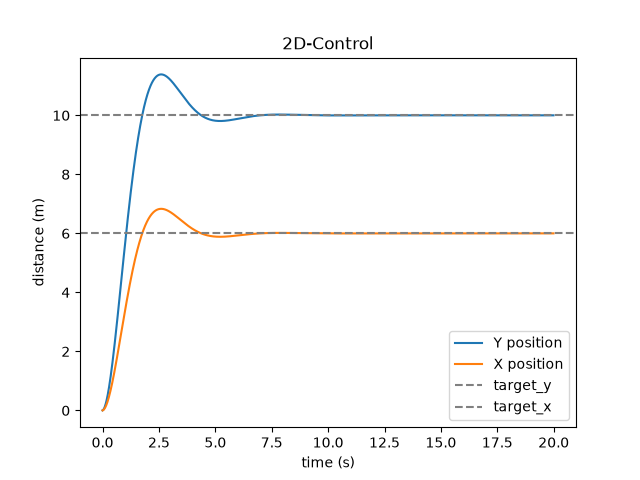
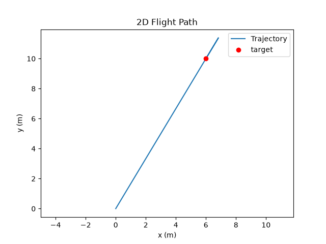
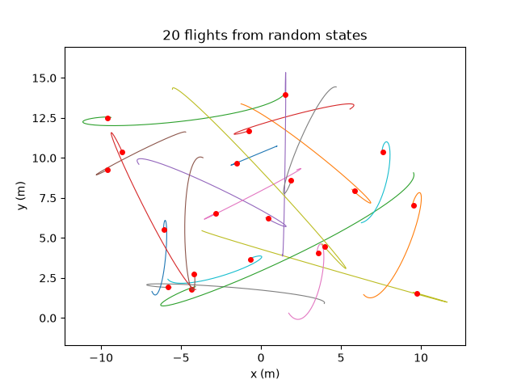

# 2D Position Control

A simulated drone flying to a target position in 2D using a PID controller on each axis.

This project is an extension of the 1D altitude-hold controller from
[altitude-hold-pid](https://github.com/glazarak/altitude-hold-pid).

## Context

x and y don't interact, so one `pid()` function is called once
per axis, with different numbers passed in. Gravity is the only asymmetry (it acts on y only).

## How it works

`pid(target, position, velocity, Kp, Kd)` returns a control force from the position error
and the current velocity.

`simulate(...)` flies a drone from a given start state to a given target and returns a
`(steps, 8)` array recording, at every timestep: `x, y, velocity_x, velocity_y,
target_x, target_y, thrust_x, thrust_y`.

Parameters: `m = 1.0 kg`, `g = 9.81`, `Kp = 2.0`, `Kd = 1.5`, `dt = 0.01 s`.

## Results

A single flight from (0, 0) to (6, 10). Both axes overshoot and settle by about 7 s.

The same flight plotted in space instead of over time. The path is straight since both axes
use the same controller and both start from rest. The line runs past the target and back, since
the overshoot is included in the graph.

20 flights from random positions, random starting velocities and random targets. These curve,
because a drone that is already moving has momentum. So it has to keep moving, cancel
the velocity off and come back. Red dots are the targets. Paths that stop short ran out of time.

## flight_data.csv

10,000 rows (20 flights × 500 timesteps), 8 columns:

| column | meaning |
|---|---|
| `x`, `y` | position (m) |
| `velocity_x`, `velocity_y` | velocity (m/s) |
| `target_x`, `target_y` | target position (m) |
| `thrust_x`, `thrust_y` | thrust the controller chose (N) |